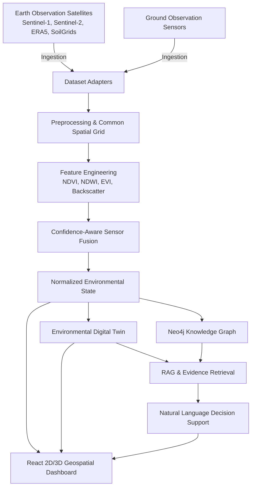

# System Architecture — BHŪ-TATTVA-ANVEṢA

## Architectural Principles
1. **Frontend Isolation**: Frontend accesses data strictly via FastAPI endpoints. Direct database calls from the frontend are prohibited.
2. **Explicit Data Provenance**: Every observation, derived feature, fused state, and simulation result carries source, timestamp, confidence, and quality flags.
3. **Data Distinction**: Clear separation between `OBSERVED_DATA`, `DERIVED_DATA`, `MODEL_ESTIMATE`, `SIMULATION`, and `SYNTHETIC_DEMO_DATA`.
